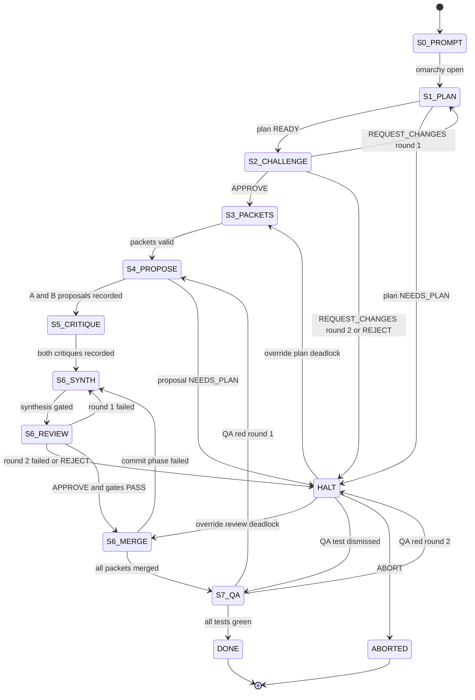

# 00_PROMPT — s000-bootstrap

Authorship: the human approved the plan reproduced below and instructed the host session (`parent`) to implement it. `parent` assembled this file from that approved plan without changing its content. This slot is human intent, transcribed by parent; it is not seat work.

## Request to the planner (`linus`)

Write `slices/s000-bootstrap/01_PLAN.r1.md`: the v3.0 kernel specification that `parent` will implement once, as the declared bootstrap exception (Plan §4.5). The specification later becomes `00_ARCHITECTURE.md`.

Scope:

- The `omarchy/` package modules, their responsibilities, and their public functions (Plan §4.2).
- Exact schemas: `agents.lock` schema 3, `slice.json`, `03_PACKETS.json`, trailer grammar, proof row, slot filename grammar (Plan §3.3–§3.8).
- The `omarchy next` transition table, refusal codes, and human rulings (Plan §3.12).
- Lineage context, worktree and merge rules, and Ollama/MLX requirements (Plan §3.9–§3.11).
- The test list the bootstrap must ship (Plan §4.4).

Keep or tighten the plan's decisions. Where you change one, state the change and why in a "Deviations from 00_PROMPT" section. The challenger (`knuth`) will contest the specification. Stages 3–7 of this slice are replaced by the bootstrap exception: there is no `03_PACKETS.json` for s000.

Hard constraints:

- No code. Specification prose, schemas, and tables only.
- At most 2 challenge rounds. A third disagreement goes to the human.
- Production code stays local-only. Cloud seats may write only plan, challenge, and packet slots, plus QA tests under `tests/qa/<slice_id>/`.

---

## Approved plan (verbatim)

---
name: Stage Pipeline v3.0
overview: "Impact audit of v2.3 against a fixed-slot, state-machine-driven slice pipeline (prompt, plan, adversarial plan pair, packets, N-version local proposals, cross-critique, synthesis, cloud QA). Decision: 3.0 restart on a new kernel package that reuses the proven v2 primitives. 73 percent of tracked files are deleted or archived, 24 percent rewritten, 3 percent kept."
todos:
  - id: p0-freeze
    content: "Phase 0 (human): push main, tag v2.3.1-attempt1, branch v3"
    status: completed
  - id: p1-s000-plan
    content: "Phase 1: s000 human prompt, cloud linus plan, cloud knuth challenge (max 2 rounds)"
    status: in_progress
  - id: p2-bootstrap-kernel
    content: "Phase 2 (parent, declared BOOTSTRAP exception): omarchy/ package + unit tests, commits trailered Omarchy-Bootstrap"
    status: pending
  - id: p3-repo-surgery
    content: "Phase 3: archive attempt-1, delete v2 files, rewrite lock/AGENTS/rule/laws atomically"
    status: pending
  - id: p4-smoke
    content: "Phase 4: omarchy smoke on both local families; EVIDENCE rows; ingest s000 cloud slots"
    status: pending
  - id: p5-rc0
    content: "Phase 5: merge v3 into main, tag v3.0.0-rc0"
    status: pending
  - id: p6-s001
    content: "Phase 6: s001 faithful whole-project audit rerun through the pipeline (challenger knuth)"
    status: pending
  - id: p7-release
    content: "Phase 7: human merges slice/s001, tag v3.0.0; s002 exercises local Family A challenger"
    status: pending
isProject: false
---

# Omarchy Stage Pipeline — Impact Audit, Version Decision, Implementation Plan

Provenance: written by a planning subagent on a cloud model in a host session. It is not a council seat ballot and carries no seat proof. The filename keeps the requested `v2_4` slug; the decision below is **3.0**.

## TL;DR

- **Decision: 3.0.** Of 63 tracked files, 2 are kept, 15 rewritten, 46 deleted (16 of them moved to an archive). Of 1,256 kernel and scheduler lines, about 350 (28 percent) are salvageable primitives, and every one of them changes module. The packet-centric model (role enum, waves, `depends_on`, resume state, Story/UC contracts) is the thing being replaced, so patching v2.3 would mean fixing code that is about to be deleted.
- **What survives** is the mechanical core: lock-as-SSOT for model slugs, path sterilization, argv-only gates, git-worktree transactions, flocked append, the Ollama call with fence stripping and no `format` field, the pre-load memory guard, and `finally` eviction.
- **What is new** is a slice directory with fixed slot files, a per-slice hash-chained proof log tracked in git, parsed trailers, and a pure state machine behind `omarchy next`.
- **Hemisphere changes**, made explicit:
  - `knuth` (cloud, `openai_gpt`) joins Core as the default challenger and QA seat. `scrum` leaves; its job becomes a deterministic command.
  - Local Family A may author a plan challenge.
  - Cloud QA seats may write tests, but only under `tests/qa/<slice_id>/`. Production code remains local-only.
- **Bootstrap.** The new kernel is built once by `parent` under a declared, recorded exception (slice `s000-bootstrap`). Then slice `s001` reruns the v2.3 whole-project audit through the real pipeline, against the bootstrap kernel itself.

---

## 1. Impact Audit

### 1.1 Evidence from attempt 1 (`docs/GRAND_COUNCIL/v2.3.1_Test/`)

The drill committed four local artifacts, but the pipeline only completed because `parent` stepped in four times. Every intervention traces to a missing mechanism.

| Observed in attempt 1 | Evidence | Root cause in v2.3 | v3 mechanism that removes it |
|---|---|---|---|
| linus planned 8 Family A packets; parent collapsed them into 1 | `FLOW_TRACE.md` "Packet collapse note" | Dependent same-family packets cost one evict/reload each (Linus N10). That created an incentive to edit the plan | Packets are frozen in slot `03_PACKETS.json`. The proof row hashes it, and `next` refuses any edit. Family sessions run every same-family job in a stage on one load, so the incentive disappears |
| parent seeded `completed_packets.json` by hand | `FLOW_TRACE.md` "Single-packet path does not write completed_packets.json; parent seeded state" | Resume state is a separate, editable file keyed by id (Linus N2) | No resume file exists. State is derived only from slot files plus the proof chain |
| parent inlined upstream outputs into downstream packets | commits `ececfcc`, `3aa8c8f` (each edits one `aud231-*.json`) | Hand-offs between stages travel through packet text that `parent` writes | Lineage rule (section 3.9): the kernel inlines every earlier slot of the slice itself. Packets are never edited after stage 3 |
| Kernel patched mid-run | `3b1f2c8` (drop `format=json`), `2e7414e` (fence strip) | Kernel identity is not pinned per run | `kernel_sha256` is pinned at `omarchy open`. Any change makes `next` return `REFUSE KERNEL_CHANGED` |
| qweny emitted `OMARCHY_STATUS: COMPLETE` (not a legal value) | `QWENY_AUDIT_WORKSHEET.md:141`; the packet instructions told it to | Parent writes the instructions and the trailer enum. The gate only checked that the line was present | The kernel owns the prompt templates and the trailer grammar. An illegal enum value is refused at record time |
| Worksheet citations about 12 lines off | worksheet cites `omarchy.py:530-531` for `MAX_FAMILY_BUDGET_BYTES`, which is at line 542 in `83ca764` | Excerpts were inlined without per-line numbers, and were truncated, which caused 11 `UNKNOWN` rows | The kernel renders whole context files with explicit line numbers. If they do not fit, the result is `HALT CONTEXT_OVERFLOW`, never truncation |
| Low-value local process audit | `SCRUM_DOD_AUDIT.md` marks its own packet `MISSING`, invents role `dod_audit`, and sums other seats' blocking counts into 31 | An LLM is asked to verify mechanical facts | `scrum` is deleted. `omarchy verify` and `omarchy status` check these facts deterministically |
| Weak `G5` | `MOXIE_G5_REVIEW.md` samples only trivial PASS rows; `MOXIE_G4_TEST.md` cites `batch_runner.py:200` for unrelated cases | A single reviewer, with no competing proposal to compare against | N-version proposals plus mandatory cross-critique. Tests are the final judge of code |

Two further defects found during this audit:

- `scripts/report_token_split.sh:48` keeps only rows with `http_code == "200"` or `status == "ready"`. The kernel writes neither field, so the report always shows zero local work.
- `scripts/ensure_local_agents.sh` matches slugs exactly. `enforce_memory_budget` matches by prefix. The two disagree.

### 1.2 Linus `LINUS_BALLOT.md` findings and where v3 resolves them

| Finding | v3 resolution | Where |
|---|---|---|
| **B1** Reverse cross-family review cannot be routed; `g4_test` and `g5_review` both map to `moxie` | Roles are deleted. Both local families author proposals (stage 4) and critique each other (stage 5). Family A synthesizes; Family B must approve (stage 6). The kernel takes the author family from the **proof row** of the reviewed slot, never from a packet claim, and refuses when the critic family equals the author family | stages 4–6, `machine.py`, tests T-M13/T-M14 |
| **B2** Verdicts and trailers are never parsed; `output_sha256` does not exist | Every slot ends in a trailer that is parsed and validated at record time. The proof row stores `status` / `verdict` / `blocking_count` and `output_sha256` (sha256 of the exact slot bytes; for local slots, the exact Ollama `response`). Transitions read only parsed verdicts | stages 1–7, `trailers.py`, `proof.py` |
| **B3** Single model in RAM is never checked; single-packet keep-warm never unloads; eviction in `finally` masks the real error | Before every load the kernel calls `GET /api/ps`, evicts any other resident model, re-checks, and fails closed if one remains. Keep-warm exists only inside `family_session`. At session exit, eviction errors are logged and the original exception is re-raised. `omarchy run` sweeps leftover lock models at start (covers SIGKILL) | all local stages, `ollama.py`, tests T-O2/T-O4 |
| N1 `cloud_g3` leaks into the local proof log | Cloud seats never reach the local runner. `omarchy run` refuses cloud slots, and cloud rows enter only through `omarchy record` | `runner.py`, `ingest.py` |
| N2 Resume keyed by id | No resume state exists | `machine.py` |
| N3 Proof is not durable; aborts leave no trace | The proof is `slices/<id>/PROOF.jsonl`, tracked and hash-chained. `SEAT_FAILED` and `CONTEXT_OVERFLOW` rows are written. Kernel commits carry trailers | `proof.py` |
| N4 Preconditions checked after the expensive step | Clean-worktree and branch checks run at command start and again immediately before merge | `worktree.py` |
| N5 Alias match coalesces sizes; constants unmeasured | Match the exact slug or `slug:latest` only. Constants get `UNMEASURED` rows. Measured `resident_bytes` from `/api/ps` goes into every row | `ollama.py`, `docs/EVIDENCE.md` |
| N6 Dead and duplicated paths | Removed with the rewrite. There is one dry path: `omarchy next` is read-only | — |
| N7 Lock parser tolerates corruption | Strict parse: wrong field count, duplicate seat, or wrong schema means fail | `lock.py`, T-L1..T-L3 |
| N8 Tests hardcode slugs and the Core seat set | Fixture locks live in `tmp_path`. The repo lock is checked against invariants, not literals | `tests/test_lock.py` |
| N9 Roster drift in always-applied docs | Docs are rewritten in one atomic commit. `test_docs_sync.py` compares the seat table and stage table to code | Phase 3 |
| N10 Same-family reloads | Family sessions per runnable job set (section 3.11) | `runner.py` |
| N11 `G2` LOC limit unenforced | `git diff --numstat` stays at or below 300 per packet at merge. A change to a dependency manifest gives `HALT DEPENDENCY_CHANGE` | `worktree.py`, T-M26 |

### 1.3 Concept audit

| Concept | Verdict | Reason |
|---|---|---|
| `role` enum + `ROLE_TO_SEAT` | DELETE | The stage table fixes who may author each slot. The lock's `CAPS` column carries the routing data |
| `batch_runner` waves, `depends_on`, write-locks | DELETE | Packets in a slice must have disjoint targets and no dependencies; dependent work becomes the next slice. All proposals start from one base, so causal waves have nothing to order |
| Family-boundary eviction | KEEP (rewritten) | Becomes the `ollama.family_session` context manager. It still runs A jobs then B jobs per stage, and still evicts in `finally` |
| 2PC worktrees | KEEP the primitive, REWRITE the usage | Stage 4 proposals run in isolated worktrees, are gated, and are recorded as a diff, **never merged**. Stage 6 is the only merge and is a real two-phase commit: prepare (synthesize and gate), vote (Family B review), commit (cherry-pick onto slice head, re-gate, fast-forward). The kernel never touches `main` |
| Proof log `.omarchy/local-agent-proof.log` (gitignored) | DELETE → NEW per-slice `PROOF.jsonl` | Adds slice, slot, round, attempt, `output_sha256`, parsed verdict, kernel and lock shas, Ollama stats, and a hash chain (section 3.8) |
| Cloud ledger `.omarchy/cloud-agent-ledger.log` | DELETE | Cloud rows live in the same slice proof, with run id and source commit |
| 105 GB memory budget guard | KEEP + extend | Adds `/api/ps` residency check, exact-slug match, and measured `resident_bytes`. `105 GiB` and `512 KiB/token` stay `UNMEASURED` in `docs/EVIDENCE.md` |
| `agents.lock` schema 2 | REWRITE → schema 3 | Adds a `CAPS` column; strict invariants (section 3.3) |
| 12 Iron Laws | REWRITE (8 of 12 keep their intent) | Section 3.14 |
| Gates `G0`–`G5` | DELETE as vocabulary | Each becomes a stage exit condition (section 3.14). The G-names drifted from code (B2) |
| `scrum` seat | DELETE | DoD and dashboard honesty become `omarchy verify` and `omarchy status`. An LLM cannot do mechanical checks better than code (attempt-1 evidence) |
| `mitnick`, `jobs` seats | DELETE | No stage needs a second Family B or a UX seat. Adversarial QA moves to cloud stage 7 |
| Story/UC contracts, `verify_story_and_uc` | DELETE | `00_PROMPT.md` plus the approved `01_PLAN` replace them |
| Demo packets `pkt-01..03`, `_sample_packet.json` | DELETE | Packet schema is gone. `pkt-02-audit` was mislabeled anyway (B1) |
| `tests/test_omarchy_kernel.py` (16 tests) | REWRITE | 5 survive in adapted form (traversal, invented slug, size downsize, missing seat, lock-family invariants). Wave and role tests are deleted |
| v2.3.1_Test artifacts | DELETE from active tree → archive as attempt 1 | They are inputs to s001's prompt and evidence of failure modes |
| MLX Ollama quirks | NEW kernel requirements | Section 3.11 (no `format`, outer-fence strip, file-block protocol, `done_reason` check) |
| Local persona files in `.cursor/agents/` | DELETE | As Cursor subagents they run on the parent's cloud model. That is the v1.0 "one name, four runtimes" failure (`K01`). Local persona text moves into kernel prompt templates |

### 1.4 File-by-file (all 63 tracked files)

"DELETE (archive)" means the file moves to `archive/v2.3.1-attempt1/`. Plain DELETE files stay reachable at tag `v2.3.1-attempt1`.

| File | Verdict | Reason |
|---|---|---|
| `.cursor/agents/linus.md` | REWRITE | Planner and packet compiler for stages 1 and 3; slot and trailer contracts; no diff review |
| `.cursor/agents/knuth.md` | REWRITE | Promoted to Core as default challenger (stage 2) and QA test author (stage 7), restricted to `tests/qa/**` |
| `.cursor/agents/dhh.md` | REWRITE | Optional cloud challenger or QA seat; hemisphere line updated |
| `.cursor/agents/carmack.md` | REWRITE | Same as `dhh` |
| `.cursor/agents/qweny.md` | DELETE | Local persona must not exist as a Cursor subagent. Text moves to `omarchy/prompts/family_a.md` |
| `.cursor/agents/moxie.md` | DELETE | Same; moves to `omarchy/prompts/family_b.md` |
| `.cursor/agents/scrum.md` | DELETE | Seat removed |
| `.cursor/agents/mitnick.md` | DELETE | Seat removed |
| `.cursor/agents/jobs.md` | DELETE | Seat removed |
| `.cursor/rules/omarchy-council.mdc` | REWRITE | Always applied. Must say: run `omarchy next` first, stage hemisphere matrix, no hand edits to slices |
| `.gitignore` | REWRITE | Drop proof, ledger, state, and token lines; keep `.omarchy/worktrees/`, `.omarchy/locks/` |
| `.omarchy/omarchy.py` | REWRITE | Split into the `omarchy/` package. Salvage map in section 4.2 |
| `.omarchy/batch_runner.py` | DELETE | Waves and resume state removed; eviction logic salvaged into `ollama.py` |
| `.omarchy/README.md` | DELETE | Module map moves to `00_ARCHITECTURE.md` |
| `.omarchy/packets/README.md` | DELETE | Packet roles removed |
| `.omarchy/packets/_sample_packet.json` | DELETE | Demo |
| `.omarchy/packets/pkt-01-impl.json`, `pkt-02-audit.json`, `pkt-03-optimize.json` | DELETE | Demo |
| `.omarchy/packets/aud231-s01-build.json`, `-s09-g4`, `-s10-g5`, `-s11-dod` | DELETE (archive) | Evidence of collapse and hand inlining |
| `.omarchy/contracts/stories/STORY-AUDIT-V231.md`, `use_cases/UC-AUDIT-V231-{WS,G4,G5,DOD}.md` | DELETE (archive) | Attempt-1 contracts |
| `.omarchy/contracts/stories/STORY-101.md`, `STORY-BATCH.md`, `use_cases/UC-101-{A,B}.md`, `UC-BATCH-{A,B}.md` | DELETE | Demo contracts |
| `00_ARCHITECTURE.md` | REWRITE | Becomes the v3 kernel contract: slice layout, schemas, state machine, invariants. Owner `linus`; content from the approved s000 plan |
| `01_OMARCHY_AGENT_PROMPTS.md` | REWRITE | 12 laws for v3, stage table, trailer grammar. Filename kept because always-applied rules cite it |
| `02_PRODUCTION_PLAN.md` | DELETE | Empty template; the roadmap lives in slices plus `docs/HISTORY.md` |
| `AGENTS.md` | REWRITE | Always applied. Section 1 becomes the stage hemisphere matrix, section 2 the schema-3 seat table, section 3 the glossary with `omarchy` commands |
| `README.md` | REWRITE | Entry point plus quickstart (absorbs `DEVELOPER_GUIDE.md` section 1) |
| `agents.lock` | REWRITE | Schema 3, `CAPS`, `knuth` in, `scrum` out |
| `agents.lock.optional` | REWRITE | `dhh`, `carmack` only |
| `docs/EVIDENCE.md` | KEEP | Append `UNMEASURED` rows for budget constants, plus measured smoke rows in Phase 4 |
| `docs/HISTORY.md` | KEEP | Append-only: attempt-1 archived, `BOOTSTRAP_EXCEPTION`, rc0, 3.0 |
| `docs/DEVELOPER_GUIDE.md` | DELETE | DoD is replaced by stage exits; quickstart moves to README |
| `docs/SPRINT_DASHBOARD.md` | DELETE | Replaced by generated `omarchy status --markdown`; no hand-edited cells |
| `docs/PRODUCT_SPEC.md` | DELETE | Empty template; `00_PROMPT.md` carries the requirements of each slice |
| `docs/OMARCHY_SCRUM_2_0_BLUEPRINT.md` | DELETE | Historical v2.0 narrative; reachable at the tag |
| `docs/TESTING_JIG_REPORT.md` | DELETE | Gate results live in proof rows and gate logs |
| `docs/GRAND_COUNCIL.md` | DELETE | Index replaced by `slices/` and `omarchy status` |
| `docs/GRAND_COUNCIL/v2.3.1_Test/*.md` (7 files) | DELETE (archive) | Attempt-1 evidence; s001 prompt cites it |
| `packets/README.md` | DELETE | Stale pointer |
| `scripts/run_local_agent.sh` | DELETE | Replaced by `scripts/omarchy` shim to `python3 -m omarchy` |
| `scripts/ensure_local_agents.sh` | REWRITE | Calls `omarchy lock --local-models`; exact slug match; no awk lock parsing |
| `scripts/log_cloud_agent.sh` | DELETE | Replaced by `omarchy record` |
| `scripts/report_token_split.sh` | DELETE | Broken (always zero local). Replaced by `omarchy status --tokens` from Ollama `eval_count` |
| `scripts/omarchy.py` | DELETE | Deprecated shim |
| `tests/test_omarchy_kernel.py` | REWRITE | Split into the test files in section 4.4 |

New files are listed in section 4.2.

### 1.5 Tally

| Verdict | Files | Share |
|---|---|---|
| KEEP | 2 | 3% |
| REWRITE | 15 | 24% |
| DELETE (archive) | 16 | 25% |
| DELETE | 30 | 48% |

---

## 2. Version Decision: 3.0

**Decision: 3.0.** The basis is the audit, not a preference:

1. **The unit of work changes.** v2 schedules *packets*. v3 schedules *slots inside a slice*. The packet schema, role enum, wave planner, resume state, and contracts make up most of the 1,256 kernel lines, and all of them are replaced. A 2.4 would first have to fix B1–B3 inside code that the target design deletes.
2. **The governance contract breaks compatibility.** The Core seat set changes (`knuth` in, `scrum` out). Law 2 is relaxed in two places (local plan review, cloud QA tests). The proof schema is incompatible, and the G-vocabulary is retired. Under semver for a governance template, that is a major version.
3. **What we reuse is proven and small:** about 350 lines of primitives, all exercised in the live drill. Reusing them inside a new package keeps the evidence while dropping the scaffolding.
4. **The doc set has to shrink.** Rewriting the six-file ontology in place would carry stale cross-references (N9) forward. Starting from 8 governance files is cheaper than reconciling 20.

### 2.1 Migration path

| Step | Action | Who |
|---|---|---|
| 1 | Push `main` (10 local commits, HEAD `1156b29`) to `origin` | human |
| 2 | Tag `1156b29` as `v2.3.1-attempt1`; push the tag. Keep `v2.1`, `v2.2.1`, `v2.3` and remote branch `cursor/linus-v2-3-1-audit-a214` (cloud-run evidence) | human |
| 3 | Create branch `v3` from `main`; push it (cloud Tasks for s000 need to see it) | human |
| 4 | On `v3`: `git mv` the 16 archive files into `archive/v2.3.1-attempt1/{council,packets,contracts}/`; add `archive/v2.3.1-attempt1/README.md` listing the four interventions with commit shas | parent (bootstrap) |
| 5 | On `v3`: delete the 30 DELETE files; land the rewrites and the new package | parent (bootstrap) |
| 6 | Fast-forward `main` to `v3`; tag `v3.0.0-rc0` | human |
| 7 | s001 runs from `main` on branch `slice/s001-kernel-audit`; human merges via PR; tag `v3.0.0` | pipeline + human |

---

## 3. Design

Principle: code enforces mechanical facts only. These are: which seat and family wrote each slot (proof), reviewer family differs from author family, the trailer exists and parses, round limits, path containment, and that hashes match. Code never ranks proposals. The synthesizer chooses, the reviewer approves, and tests are the final judge.

### 3.1 Stage table

| Stage | Slot file(s) in `slices/<id>/` | Author | Runtime | Exit to next stage | Loop limit |
|---|---|---|---|---|---|
| 0 | `slice.json`, `00_PROMPT.md` | human | editor + `omarchy open` | config valid; open row recorded | — |
| 1 | `01_PLAN.r{n}.md` | planner (`linus`) | cloud | `OMARCHY_STATUS: READY` + `PLAN_FILES` | `NEEDS_PLAN` or `UNKNOWN` → HALT |
| 2 | `02_CHALLENGE.r{n}.md` | challenger from `slice.json`: cloud seat with family different from planner, **or** `qweny` (Family A) | cloud or local | `APPROVE` → 3; `REQUEST_CHANGES` → 1 at r+1 | 2 rounds, then HALT; `REJECT` → HALT |
| 3 | `03_PACKETS.json` | planner (`linus`) | cloud | schema valid, `plan_sha256` equals the approved plan revision, targets disjoint and within `PLAN_FILES` | 2 record attempts |
| 4 | `04_<pkt>.q{q}.A.md`, `04_<pkt>.q{q}.B.md` (+ kernel `.diff`, `.gates.log`) | Family A and Family B independently, isolated worktrees, never merged | local | both recorded `READY`, gates recorded (not blocking) | `NEEDS_PLAN` → HALT |
| 5 | `05_<pkt>.q{q}.A_ON_B.md`, `05_<pkt>.q{q}.B_ON_A.md` | each family critiques the other's proposal | local | both verdict trailers parse; critic family differs from author family | — |
| 6 | `06_<pkt>.q{q}.SYNTH.r{n}.md` (+ `.diff`, `.gates.log`), `06_<pkt>.q{q}.REVIEW.r{n}.md` | Family A synthesizes in tx worktree; Family B reviews | local | gates PASS and `APPROVE` → kernel merge into `slice/<id>` | 2 rounds, then HALT |
| 7 | `07_QA.q{q}.<seat>.md` + `tests/qa/<id>/**` | `qa_seats` from `slice.json` (cloud, never the planner) | cloud | `test_command` + all QA tests green → DONE; red → stage 4 at q+1 for mapped packets | 2 QA rounds, then HALT |

"Back to stage 5" in stage 6 means: Family B's `REVIEW` slot *is* the stage-5-class critique of the synthesis (only Family B may critique a Family A artifact). The next `SYNTH` reads it.

### 3.2 Hemisphere and token routing (replaces `AGENTS.md` section 1)

| Artifact | Permitted author | Mechanism | Proof |
|---|---|---|---|
| `slice.json`, `00_PROMPT.md`, HALT rulings | human | editor, `omarchy open`, `omarchy rule` | row `seat_id=human` |
| `01_PLAN`, `03_PACKETS` | `linus` (cloud) | Cloud Task → `omarchy record` | row with `cloud_run_id`, `source_commit` |
| `02_CHALLENGE` | configured challenger: cloud seat (family different from `linus`) or `qweny` | cloud: `record`; local: `omarchy run` | row |
| Production code + unit tests (stage 4 proposals, stage 6 synthesis) | **local families only** | `omarchy run` | row with Ollama stats and `diff_sha256` |
| Critiques and reviews (stages 5, 6) | local families, always cross-family | `omarchy run` | row with parsed verdict |
| Adversarial tests (stage 7) | cloud QA seats, **only** under `tests/qa/<slice_id>/` | Cloud Task → `omarchy record` (path-restricted) | row |
| Kernel and docs during bootstrap | `parent`, once, under human authorization | `slices/s000-bootstrap/BOOTSTRAP.json` | commit trailer `Omarchy-Bootstrap: parent` |
| Merge `slice/<id>` → `main` | human | PR | git |

There are three explicit changes from v2.3, and adopting this plan is the human approval for them:

- **(a)** Core needs a second cloud family, so `knuth` joins Core.
- **(b)** Local Family A may author a plan challenge. It reviews; it never edits the plan.
- **(c)** Cloud seats may author test files under `tests/qa/<slice_id>/` and nothing else. `omarchy record` refuses any other path, and stages 4 and 6 refuse cloud authors.

`parent` runs commands and dispatches cloud Tasks with kernel-generated prompts. It never writes slot files. The hash chain and the commit audit (section 3.8) detect any hand edit.

### 3.3 Seats and `agents.lock` schema 3

```text
schema=3
# SEAT|GROUP|RUNTIME|FAMILY|MODEL|CAPS|WEIGHT
linus|grand_council|cloud|anthropic_opus|claude-opus-5-5-high|plan|Planner and packet compiler
knuth|grand_council|cloud|openai_gpt|gpt-5.6-sol-high|challenge,qa|Plan challenger and adversarial QA
qweny|local_council|local|local_family_a|qwen3.8:27b-mlx|challenge,propose,critique,synthesize|Local Family A
moxie|local_council|local|local_family_b|gemma4:31b-mlx|propose,critique,review|Local Family B
parent|orchestrator|host|host|host_session|host|Router; runs commands; never authors slots
```

`agents.lock.optional` keeps `dhh` (`muse_spark`) and `carmack` (`xai_grok`), both `challenge,qa`. `human` is a reserved seat id that is not in the lock.

The lock invariants below are enforced by `lock.py`. Any violation is fatal at parse time.

| Invariant |
|---|
| `schema=3` present; every row has exactly 7 fields; seat ids are unique |
| Exactly one seat has `plan`, and it is `cloud` |
| Exactly one local seat per local family (A and B), and the two models differ |
| Cloud seat families are pairwise distinct |
| `synthesize` appears only on Family A; `review` only on Family B; `propose` and `critique` on both local seats |
| `qa` appears only on cloud seats other than the planner |
| `challenge` appears only on cloud seats whose family differs from the planner's, or on the Family A seat |
| Caps come from the closed set `{plan, challenge, qa, propose, critique, synthesize, review, host}` |

### 3.4 Slice directory layout

```text
slices/<slice_id>/
  slice.json                       human
  00_PROMPT.md                     human
  01_PLAN.r1.md  01_PLAN.r2.md     linus
  02_CHALLENGE.r1.md  .r2.md       challenger
  03_PACKETS.json                  linus
  04_<pkt>.q1.A.md  .A.diff  .A.gates.log
  04_<pkt>.q1.B.md  .B.diff  .B.gates.log
  05_<pkt>.q1.A_ON_B.md  05_<pkt>.q1.B_ON_A.md
  06_<pkt>.q1.SYNTH.r1.md  .r1.diff  .r1.gates.log
  06_<pkt>.q1.REVIEW.r1.md
  07_QA.q1.<seat>.md
  HALT.<n>.HUMAN.md                human ruling (only after HALT)
  PROOF.jsonl                      kernel only
tests/qa/<slice_id>/**             stage 7 test files
```

The `.md` slot files for local seats are the **exact** Ollama `response` bytes. Parsing (fence strip, file blocks, trailer) happens on read, so `output_sha256` equals the sha256 of the slot file. `.diff` and `.gates.log` files are kernel-derived, and their hashes are stored in the same row.

### 3.5 `slice.json`

```json
{
  "schema": 3,
  "slice_id": "s001-kernel-audit",
  "title": "Faithful whole-project audit of v3.0.0-rc0",
  "base_ref": "main",
  "challenger_seat": "knuth",
  "qa_seats": ["knuth"],
  "test_command": [["python3", "-m", "pytest", "-q"]],
  "context_files": ["omarchy/machine.py", "omarchy/proof.py"],
  "num_ctx": 32768,
  "max_packets": 4
}
```

Unknown keys are rejected. `challenger_seat` is the only pipeline-shape configuration. The planner is the unique `plan` seat, the synthesizer is the Family A seat, and the reviewer is the Family B seat. None of those are configurable.

Challenger legality, checked at `omarchy open` and again at every stage-2 record or run:

```text
legal(c) := c in lock
            and "challenge" in caps(c)
            and ( (runtime(c) == cloud and family(c) != family(planner))
                  or (runtime(c) == local and family(c) == local_family_a) )
```

QA legality: `qa_seats` is non-empty, and every entry is a cloud seat with `qa` that is not the planner. The challenger may also be a QA seat.

### 3.6 `03_PACKETS.json`

```json
{
  "schema": 3,
  "plan_sha256": "<sha256 of the approved 01_PLAN.rN.md>",
  "packets": [
    {
      "packet_id": "pkt-01",
      "title": "Strict lock parse",
      "plan_section": "3.2",
      "instructions": "...",
      "acceptance": ["Given ... When ... Then ..."],
      "target_files": ["omarchy/lock.py", "tests/test_lock.py"],
      "context_files": ["omarchy/slice.py"],
      "verification_commands": [["python3", "-m", "pytest", "-q", "tests/test_lock.py"]]
    }
  ]
}
```

Kernel checks:

- packet count is between 1 and `max_packets`; ids are unique and match `^pkt-[0-9]{2}$`
- each packet has 1 to 5 `target_files`
- `target_files` are pairwise disjoint across packets and contained in the approved plan's `PLAN_FILES`
- no target is under `slices/` or `tests/qa/`
- all paths are sterilized against the repo root
- `verification_commands` are argv lists

There are no `role`, `family`, `model`, `depends_on`, or `base_branch` fields.

### 3.7 Response and trailer formats

Every slot ends with a single trailer block delimited by `---` lines. The kernel parses only the last block. Each key appears exactly once, and enums are closed.

| Slot class | Required trailer keys |
|---|---|
| Plan (`01`) | `OMARCHY_STATUS: READY \| NEEDS_PLAN \| UNKNOWN`, `PLAN_FILES: <comma paths>`, `OMARCHY_PROMPT_SHA256: <hex>` |
| Challenge, critique, review (`02`, `05`, `06 REVIEW`) | `OMARCHY_VERDICT: APPROVE \| REQUEST_CHANGES \| REJECT`, `BLOCKING_COUNT: <int>`, `CITED_LOCATIONS: <path:line, ...> \| NONE` (cloud slots also carry `OMARCHY_PROMPT_SHA256`) |
| Proposal, synthesis (`04`, `06 SYNTH`) | `OMARCHY_STATUS: READY \| NEEDS_PLAN \| UNKNOWN`, `TOUCHED_FILES: <comma paths>`, `MISSING_SYMBOLS: NONE \| <list>` |
| QA report (`07`) | `OMARCHY_STATUS: READY`, `QA_TESTS: <test_id> -> <pkt-NN>; ...`, `OMARCHY_PROMPT_SHA256: <hex>` |
| Human ruling | `HUMAN_RULING: ABORT \| APPROVE_OVERRIDE \| DISMISS_QA_TEST <paths> \| APPROVE_DEPENDENCY \| RETRY`, `REASON: <text>` |

Consistency rules:

- `APPROVE` requires `BLOCKING_COUNT: 0`; `REQUEST_CHANGES` requires at least 1.
- `APPROVE_WITH_FIXES` is removed, because a state machine needs a binary exit.
- `READY` proposals must contain at least one file block, and every block path must be in that packet's `target_files`.

Code is carried in file blocks, not JSON. MLX Ollama does not enforce JSON anyway (it returns 501 for `format`), and JSON-escaping whole files is the main way local models produce invalid output.

```text
=== FILE: omarchy/lock.py ===
<complete file contents>
=== END_FILE ===
```

`OMARCHY_PROMPT_SHA256` must equal the sha of the kernel-generated prompt for that slot (`omarchy prompt <slice> <slot>`). This shows the cloud seat received the canonical prompt. It does not prove nothing was appended, and that limit is stated in `AGENTS.md`.

### 3.8 Proof row (`slices/<id>/PROOF.jsonl`, one JSON object per line)

| Field | Meaning |
|---|---|
| `seq`, `prev_sha256` | Monotonic index; sha256 of the previous line's bytes (hash chain) |
| `time`, `slice_id`, `stage`, `slot`, `packet_id`, `qa_round`, `round`, `attempt` | Position in the state machine |
| `seat_id`, `family`, `model`, `runtime` | Resolved from the pinned lock, never from slot text |
| `kernel_sha256`, `lock_sha256` | Pinned at open; must match on every row |
| `base_commit` | Slice-branch commit the job started from |
| `prompt_sha256` | Kernel-built prompt; regenerated byte-identically by `omarchy prompt` |
| `output_sha256` | sha256 of slot file bytes |
| `diff_sha256`, `gates`, `gates_log_sha256`, `numstat_loc` | Code slots only; `gates` is `PASS`, `FAIL`, or `NA` |
| `status`, `verdict`, `blocking_count` | Parsed trailer |
| `outcome` | `RECORDED`, `SEAT_FAILED`, `CONTEXT_OVERFLOW`, `MERGED`, `QA_EVAL`, `HALT`, `RULING`, `OPEN` |
| `cloud_run_id`, `source_ref`, `source_commit` | Cloud slots only |
| `ollama` | `{eval_count, prompt_eval_count, total_duration_ns, done_reason, resident_bytes}`, measured |

Every mutating command writes its row and its slot files in a single kernel commit on `slice/<id>`. The commit uses conventional-commit subjects (for example `chore(s001): record 04_pkt-01.q1.A`) with trailers `Omarchy-Slice`, `Omarchy-Slot`, `Omarchy-Seat`, `Omarchy-Output-Sha256`. `omarchy verify` walks `base..slice/<id>` and refuses if any commit lacks the trailers or touches files other than its slot's allowed set.

### 3.9 Lineage context (replaces packet hand-offs)

A slot reads the following, in this order:

1. every slot of stages 0–3;
2. for per-packet stages, every earlier slot with the same `packet_id`, from strictly earlier stages, plus earlier rounds of its own stage loop;
3. the packet's `target_files` and `context_files` plus the slice's `context_files`, rendered at `base_commit` with explicit line numbers.

Stage-5 critiques never see the other critique, which keeps them independent. Sibling packets' slots are not lineage.

Cloud seats are told to read the same set from the pushed slice branch. Local prompts get it inlined by the kernel. If the estimated tokens (chars / 3.5, an `UNMEASURED` heuristic) plus a 4,096-token reserve exceed `num_ctx`, the kernel writes a `CONTEXT_OVERFLOW` row and the slice HALTs. Nothing is ever truncated.

### 3.10 Worktrees and merges

- The kernel owns a slice worktree at `.omarchy/worktrees/<slice_id>/slice` on `slice/<id>`. The human's checkout is never used, which removes the dirty-main-tree failure.
- **Proposals:** worktree `omarchy/<id>/<pkt>/q{q}/{A|B}` from `base_commit` → apply file blocks → run `verification_commands` + `test_command` → store `.diff` and `.gates.log` → remove the worktree and delete the branch. They never merge.
- **Synthesis (2PC):** prepare = tx worktree from slice head plus synthesized files plus gates, with the tx branch kept. Vote = Family B review. Commit = only if gates PASS and `APPROVE`: cherry-pick onto the current slice head in a fresh worktree, re-run gates, check numstat at or below 300 LOC and no dependency manifest touched, then fast-forward `slice/<id>` and write a `MERGED` row. Any commit-phase failure counts as a failed round. Rejection deletes the tx branch.
- **QA:** `omarchy record` copies only `07_QA.*` and `tests/qa/<id>/**` from the cloud ref, after checking that the ref's merge-base equals the slice head and that `git diff --name-only` stays within the allowed set. QA tests are committed whether they pass or fail. Red tests become part of the mapped packet's gates in round q+1.

### 3.11 Ollama and MLX kernel requirements; memory

| ID | Requirement |
|---|---|
| K1 | Never send `format` (MLX returns HTTP 501) |
| K2 | Strip at most one outer markdown fence around the whole response; never touch inner fences |
| K3 | Code travels in file blocks; trailer is the last `---` block |
| K4 | `done_reason == "length"` → `SEAT_FAILED` (truncated), never a parse attempt |
| K5 | Before each load: `GET /api/ps`; evict any non-target resident model; re-check; fail closed if still resident. Record measured `resident_bytes` after load |
| K6 | `keep_alive: "15m"` only inside `family_session`; session exit sends `keep_alive: 0` and verifies via `/api/ps`; eviction errors never mask the original exception |
| K7 | `omarchy run` start: evict any lock model already resident (SIGKILL leftovers) |
| K8 | Budget guard: weights (exact slug or `slug:latest` from `/api/tags`) + `num_ctx` × 512 KiB + 4 GiB ≤ 105 GiB; constants `UNMEASURED` |
| K9 | Temperature 0; determinism not assumed; per-call timeout 3,600 s → `SEAT_FAILED`; one automatic retry, then HALT |

Scheduling: `omarchy run` asks the machine for the set of runnable local jobs. It prefers the family already resident, otherwise Family A. Within one session it keeps running newly runnable jobs of that family. One synthesis round costs four loads (A proposals | B proposals and B critiques | A critiques and A synthesis | B reviews), not one per packet. Wall-clock cost is `UNMEASURED`. Running both families in RAM in parallel is out of scope until `docs/EVIDENCE.md` shows both fit.

### 3.12 CLI and the `omarchy next` state machine

| Command | Effect |
|---|---|
| `omarchy open <id>` | Validate `slice.json`, `00_PROMPT.md`, and the lock; create `slice/<id>` from `base_ref`; write the `OPEN` row with kernel and lock shas |
| `omarchy next <id>` | Read-only. Prints exactly one of `NEXT`, `HALT`, `DONE`, `REFUSE`. Exit codes 0 / 3 / 4 / 65 |
| `omarchy prompt <id> <slot>` | Print the canonical prompt for a cloud slot |
| `omarchy record <id> --slot S --seat X --ref R --cloud-run ID` | Ingest a cloud slot (and, for stage 7, QA tests) |
| `omarchy run <id>` | Execute all runnable local jobs and kernel actions (merge, QA evaluation) |
| `omarchy rule <id>` | Record `HALT.<n>.HUMAN.md` after HALT |
| `omarchy verify <id>` / `--repo` | Chain, slot shas, commit audit, pins; `--repo` also reports bootstrap coverage |
| `omarchy status [--markdown] [--tokens]` | Generated dashboard across slices; replaces `SPRINT_DASHBOARD.md` and `report_token_split.sh` |
| `omarchy smoke` | One tiny proposal per local family; records parse success and `resident_bytes` to stdout for `EVIDENCE.md` |

Before any `NEXT`, the machine runs integrity checks. Any failure prints `REFUSE <code>`. The codes are `CHAIN_BROKEN`, `SLOT_SHA_MISMATCH`, `KERNEL_CHANGED`, `LOCK_CHANGED`, `FOREIGN_COMMIT`, `UNKNOWN_SLOT_FILE`, `WRONG_SEAT_FOR_SLOT`, `SAME_FAMILY_CRITIQUE`, `OUT_OF_ORDER`, `DUPLICATE_SLOT`, and `ILLEGAL_CONFIG`.

Transitions, evaluated in order. `q` is the QA round and `r` is the inner round.

| # | Condition (from slots and rows) | `next` output | Actor |
|---|---|---|---|
| 1 | No `OPEN` row | `REFUSE NOT_OPEN` | human runs `open` |
| 2 | Open, no `01_PLAN.r1` | `NEXT CLOUD linus 01_PLAN.r1.md` | parent dispatches, then `record` |
| 3 | `01_PLAN.r{n}` status not `READY` | `HALT PLAN_NEEDS_INPUT` | human |
| 4 | `01_PLAN.r{n}` READY, no `02_CHALLENGE.r{n}` | `NEXT CLOUD <challenger>` or `NEXT LOCAL local_family_a` | `record` or `run` |
| 5 | `02.r{n}` = `REJECT` | `HALT PLAN_REJECTED` | human |
| 6 | `02.r1` = `REQUEST_CHANGES` | `NEXT CLOUD linus 01_PLAN.r2.md` | parent, then `record` |
| 7 | `02.r2` = `REQUEST_CHANGES` | `HALT PLAN_DEADLOCK` | human |
| 8 | `02.r{n}` = `APPROVE`, no `03` | `NEXT CLOUD linus 03_PACKETS.json` | parent, then `record` |
| 9 | `03` valid; any packet missing `04.q{q}.A` or `.B` | `NEXT LOCAL` with the job list | `run` |
| 10 | Any `04` status not `READY` | `HALT PROPOSAL_NEEDS_PLAN` | human |
| 11 | Both `04` present, a `05` missing | `NEXT LOCAL` with critique jobs | `run` |
| 12 | Both `05` present, open packet lacks `SYNTH.r{r}` | `NEXT LOCAL local_family_a` synth jobs | `run` |
| 13 | `SYNTH.r{r}` present, `REVIEW.r{r}` missing | `NEXT LOCAL local_family_b` review jobs | `run` |
| 14 | `REVIEW.r{r}` = `APPROVE` and gates PASS, not yet `MERGED` | `NEXT KERNEL merge <pkt>` | `run` |
| 15 | Diff touches a dependency manifest | `HALT DEPENDENCY_CHANGE` | human |
| 16 | `REVIEW` = `REJECT` | `HALT SYNTH_REJECTED` | human |
| 17 | Round failed (not approved, gates fail, or commit-phase fail), r = 1 | `NEXT LOCAL local_family_a SYNTH.r2` | `run` |
| 18 | Round failed, r = 2 | `HALT SYNTH_DEADLOCK` (last gates PASS) or `HALT TESTS_RED` | human |
| 19 | All packets in round q `MERGED`, a QA seat lacks `07_QA.q{q}` | `NEXT CLOUD <qa_seat> 07_QA.q{q}.<seat>.md` | parent, then `record` |
| 20 | All `07_QA.q{q}` recorded, no `QA_EVAL` row | `NEXT KERNEL qa_eval` | `run` |
| 21 | `QA_EVAL` green | `DONE` | human opens PR |
| 22 | `QA_EVAL` red, q = 1 | `NEXT LOCAL` with q=2 proposals for packets mapped by `QA_TESTS` | `run` |
| 23 | `QA_EVAL` red, q = 2 | `HALT QA_RED` | human |
| 24 | Last row for a job `SEAT_FAILED`, attempt 1 | `NEXT` (same job, attempt 2) | `run` or `record` |
| 25 | `SEAT_FAILED` attempt 2, or `CONTEXT_OVERFLOW` | `HALT SEAT_FAILED` / `HALT CONTEXT_OVERFLOW` | human |

Legal human rulings per HALT. Every HALT also accepts `ABORT`, which is terminal; a new slice may cite the aborted one in its prompt.

| HALT | Additional legal ruling | Effect |
|---|---|---|
| `PLAN_DEADLOCK` | `APPROVE_OVERRIDE` | Latest plan revision treated as approved → row 8 |
| `SYNTH_DEADLOCK` | `APPROVE_OVERRIDE` (only if the latest synth gates PASS) | → row 14 |
| `QA_RED` | `DISMISS_QA_TEST <paths>` | Kernel deletes those tests in the ruling commit → row 20 |
| `DEPENDENCY_CHANGE` | `APPROVE_DEPENDENCY` | → row 14 |
| `SEAT_FAILED` | `RETRY` (once per job) | Attempt counter reset once |
| `TESTS_RED`, `PLAN_REJECTED`, `SYNTH_REJECTED`, `PLAN_NEEDS_INPUT`, `PROPOSAL_NEEDS_PLAN`, `CONTEXT_OVERFLOW` | none | Tests and Law 4 cannot be overridden |

### 3.13 State diagram (one packet lineage shown; stages 4–6 run per packet)



### 3.14 Laws and gates mapped to v3

| v2 Law | v3 | Mechanical enforcement |
|---|---|---|
| 1 Plan before code | KEEP | Stage order; stage 4 is unreachable without an approved plan and valid packets |
| 2 Hemisphere separation | REWRITE | Section 3.2 matrix; path-restricted ingest; stages 4 and 6 refuse cloud authors |
| 3 Self-contained packets | REWRITE as "Lineage context" | Kernel inlines lineage with line numbers; overflow → HALT |
| 4 `UNKNOWN` over invention | KEEP | `NEEDS_PLAN` / `UNKNOWN` → HALT |
| 5 Cross-family check | KEEP, now enforced | Author family taken from proof rows; `SAME_FAMILY_CRITIQUE` refusal |
| 6 Proof of execution | REWRITE | `PROOF.jsonl` schema, hash chain, commit audit |
| 7 Mechanical reproduction | REWRITE as "Tests judge code" | Kernel runs gates; no agent claim counts |
| 8 Zero silent dependencies | KEEP | Manifest-touch → `HALT DEPENDENCY_CHANGE` |
| 9 Fail-closed honesty | KEEP | Strict parsers everywhere |
| 10 `UNMEASURED` until proven | KEEP | Budget constants and cost figures; `resident_bytes` measured |
| 11 No ghostwriting | KEEP, now enforced | Only kernel commits on slice branches; slot sha check |
| 12 Deadlock halt | REWRITE as "Two rounds, then HALT" | Uniform round limits plus legal rulings table |

| v2 Gate | v3 stage exit |
|---|---|
| `G0` Provenance | Every transition: `verify` integrity checks |
| `G1` Testing Jig | Stage 4 (recorded), stage 6 commit phase (must pass), stage 7 `QA_EVAL` (must pass) |
| `G2` Hygiene | Stage 3 packet schema; stage 6 numstat and manifest checks |
| `G3` Structural (`linus`) | Stage 2 challenger approval of the `linus` plan |
| `G4` Specialist | Stage 7 cloud QA |
| `G5` Cross-family peer | Stage 5 critiques plus stage 6 Family B review |

---

## 4. Implementation Plan

### 4.1 Phases

| Phase | Work | Output | Who |
|---|---|---|---|
| 0 | Push `main`; tag `v2.3.1-attempt1`; branch and push `v3` | tag, branch | human |
| 1 | Write `slices/s000-bootstrap/slice.json` (challenger `knuth`, qa `knuth`) and `00_PROMPT.md` (may cite sections of this plan). Dispatch `linus` for `01_PLAN.r1.md` (the v3 kernel specification, which later becomes `00_ARCHITECTURE.md`), then `knuth` for `02_CHALLENGE.r1.md`; at most 2 rounds. Cloud commits stay on their cloud branches for later ingest | approved s000 plan, or human HALT ruling | human, cloud |
| 2 | Bootstrap kernel per the approved s000 plan, tests first, one module per commit at or below 300 LOC, trailer `Omarchy-Bootstrap: parent`. Write `BOOTSTRAP.json` listing every file and its sha | `omarchy/` package plus tests green | parent (declared exception) |
| 3 | Repo surgery in one atomic commit: archive moves, deletions, rewrites of `agents.lock`, `agents.lock.optional`, `AGENTS.md`, `.cursor/rules/omarchy-council.mdc`, `01_`, `00_`, `README.md`, `.gitignore`, cloud personas, `ensure_local_agents.sh`; `HISTORY.md` rows | slim tree; `test_docs_sync.py` green | parent (declared exception) |
| 4 | `scripts/ensure_local_agents.sh`; `omarchy smoke` on both families; record measured rows in `docs/EVIDENCE.md`; `omarchy record` the s000 cloud slots from their cloud refs so s000 has a real proof chain | EVIDENCE rows; `omarchy next s000` → `DONE_BOOTSTRAP` | parent, human |
| 5 | Fast-forward `main` to `v3`; tag `v3.0.0-rc0` | rc0 | human |
| 6 | s001 (section 4.5) | `slice/s001-kernel-audit` at `DONE` | pipeline |
| 7 | PR-merge s001; tag `v3.0.0`. Open s002, a small slice with `challenger_seat: qweny`, to exercise the local challenger path live | v3.0.0 | human, pipeline |

### 4.2 Package layout and salvage map

LOC figures are estimates and are `UNMEASURED`.

| New file | Est. LOC | Salvaged from v2 | Responsibility |
|---|---|---|---|
| `omarchy/__init__.py`, `omarchy/__main__.py` | 120 | `parse_args`, `main` | CLI dispatch, exit codes |
| `omarchy/lock.py` | 150 | `parse_agents_lock`, `locked_local_family_models` | Schema-3 strict parse; invariants; legality helpers |
| `omarchy/slice.py` | 180 | `sterilize_path` | `slice.json`, `03_PACKETS.json` validation; slot naming grammar |
| `omarchy/proof.py` | 140 | `append_locked_log` | JSONL append under flock; chain verify; commit-trailer audit |
| `omarchy/trailers.py` | 160 | fence strip in `invoke_ollama_serial` | Trailer grammar; file-block parser; consistency rules |
| `omarchy/machine.py` | 300 | none | Pure `next_step(cfg, lock, rows, files) -> Step`; no IO |
| `omarchy/worktree.py` | 200 | `WorktreeTransaction`, `run_deterministic_gates`, `apply_agent_changes` | Proposal and tx worktrees; gates with captured logs; numstat |
| `omarchy/ollama.py` | 200 | `invoke_ollama_serial`, `enforce_memory_budget`, `evict_model`, `force_unload_model`, batch `finally` | `/api/ps`, budget, `family_session` |
| `omarchy/runner.py` | 220 | `build_agent_prompt` | Lineage prompt build with line numbers; job scheduling by family |
| `omarchy/ingest.py` | 140 | none | `record` for cloud refs; path allow-lists |
| `omarchy/prompts/{plan,challenge,packets,propose,critique,synthesize,review,qa}.md`, `family_a.md`, `family_b.md` | — | persona text from `qweny.md`, `moxie.md` | Stage templates (part of `kernel_sha256`) |
| `scripts/omarchy` | 3 | none | `exec python3 -m omarchy "$@"` |
| `slices/s000-bootstrap/{slice.json,00_PROMPT.md,BOOTSTRAP.json,...}` | — | none | Bootstrap record |
| `archive/v2.3.1-attempt1/README.md` | 40 | none | Failure list with commit shas |
| `tests/test_{lock,slice_config,trailers,proof,machine,ollama,worktree,ingest,runner,docs_sync}.py` | ~900 | 5 adapted v2 tests | Section 4.4 |

### 4.3 Kernel-pinning rule for self-hosting

The kernel that runs is always the one in the human's checkout of `main`. A slice that edits kernel files changes only its own slice branch, so the running kernel and `kernel_sha256` stay fixed for the whole slice. A new kernel takes effect only after a human merges the slice and a **new** slice is opened. That is how s001 can rebuild the kernel without patching it mid-run, the attempt-1 failure.

### 4.4 Test list

All tests run without Ollama or network. Git tests use a `tmp_path` repo; Ollama tests mock HTTP.

| ID | File | Asserts |
|---|---|---|
| T-L1 | `test_lock.py` | `schema` other than 3 → error |
| T-L2 | | Row with 6 or 8 fields → error (not skipped) |
| T-L3 | | Duplicate seat id → error |
| T-L4 | | Two seats in one local family → error |
| T-L5 | | Family A model equals Family B model → error |
| T-L6 | | Two cloud seats share a family → error |
| T-L7 | | Zero or two `plan` seats → error |
| T-L8 | | `synthesize` on B, or `review` on A → error |
| T-L9 | | `qa` on planner; `challenge` on Family B → error |
| T-L10 | | Repo `agents.lock` satisfies all invariants (no literal slugs, no exact seat-set assertion) |
| T-L11 | | Invented slug and size downsize rejected (adapted v2 tests) |
| T-C1 | `test_slice_config.py` | Challenger cloud seat with family different from planner → legal |
| T-C2 | | Challenger `qweny` (Family A) → legal |
| T-C3 | | Challenger `moxie` (Family B) → `ILLEGAL_CONFIG` |
| T-C4 | | Challenger is the planner → `ILLEGAL_CONFIG` |
| T-C5 | | Empty `qa_seats`; QA seat is planner; QA seat local → `ILLEGAL_CONFIG` |
| T-C6 | | Unknown key in `slice.json` → rejected |
| T-C7 | | `context_files` path escapes repo → `SECURITY VIOLATION` (adapted v2 traversal test) |
| T-T1 | `test_trailers.py` | Review slot missing `OMARCHY_VERDICT` → refused at record |
| T-T2 | | Duplicate trailer key → refused |
| T-T3 | | `APPROVE` with `BLOCKING_COUNT: 2`; `REQUEST_CHANGES` with 0 → refused |
| T-T4 | | `OMARCHY_STATUS: COMPLETE` and `APPROVE_WITH_FIXES` → refused |
| T-T5 | | Whole response wrapped in a json fence → parsed; inner fences in file content preserved |
| T-T6 | | File block outside `target_files` → refused |
| T-T7 | | File block path escaping worktree → refused |
| T-T8 | | Cloud slot `OMARCHY_PROMPT_SHA256` mismatch → refused |
| T-T9 | | `READY` proposal with zero file blocks → refused |
| T-T10 | | Plan without `PLAN_FILES` → refused |
| T-P1 | `test_proof.py` | Append and verify chain |
| T-P2 | | Slot file edited after record → `REFUSE SLOT_SHA_MISMATCH` |
| T-P3 | | Middle row edited or deleted → `REFUSE CHAIN_BROKEN` |
| T-P4 | | Kernel sha differs from `OPEN` row → `REFUSE KERNEL_CHANGED` |
| T-P5 | | Lock sha differs → `REFUSE LOCK_CHANGED` |
| T-P6 | | Two concurrent appenders under flock → chain valid |
| T-P7 | | Hand commit on `slice/<id>` without trailers → `REFUSE FOREIGN_COMMIT` |
| T-M1 | `test_machine.py` | Fresh open → `NEXT CLOUD linus 01_PLAN.r1.md` |
| T-M2 | | Plan recorded by non-planner seat → `REFUSE WRONG_SEAT_FOR_SLOT` |
| T-M3 | | Plan `NEEDS_PLAN` → `HALT PLAN_NEEDS_INPUT` |
| T-M4 | | Challenge by a seat other than the configured challenger → `REFUSE WRONG_SEAT_FOR_SLOT` |
| T-M5 | | `REQUEST_CHANGES` r1 → plan r2; r2 `REQUEST_CHANGES` → `HALT PLAN_DEADLOCK` |
| T-M6 | | `REJECT` r1 → `HALT PLAN_REJECTED` |
| T-M7 | | Challenger cloud → `NEXT CLOUD`; challenger `qweny` → `NEXT LOCAL local_family_a` (both legal) |
| T-M8 | | `plan_sha256` not equal to approved revision → refused |
| T-M9 | | Overlapping targets; target outside `PLAN_FILES`; 6 targets; packets above `max_packets` → refused |
| T-M10 | | Stage-4 proposal recorded from a cloud seat → `REFUSE WRONG_SEAT_FOR_SLOT` |
| T-M11 | | Only A proposals present → `NEXT LOCAL local_family_b`, not stage 5 |
| T-M12 | | Proposal `NEEDS_PLAN` → `HALT PROPOSAL_NEEDS_PLAN` |
| T-M13 | | `A_ON_B` authored by Family B (same-family critique) → `REFUSE SAME_FAMILY_CRITIQUE` |
| T-M14 | | `SYNTH` authored by B, or `REVIEW` authored by A → refused |
| T-M15 | | Gates FAIL with `APPROVE` → not merged, r2; r2 fails → `HALT TESTS_RED` |
| T-M16 | | Gates PASS with `REQUEST_CHANGES` r1, r2 `APPROVE` → `NEXT KERNEL merge` |
| T-M17 | | All packets merged → `NEXT CLOUD <qa_seat>` for each QA seat |
| T-M18 | | QA record touching a path outside `tests/qa/<id>/` → refused |
| T-M19 | | QA red mapped to `pkt-02` → q2 proposals for `pkt-02` only; q2 red → `HALT QA_RED` |
| T-M20 | | QA green → `DONE` |
| T-M21 | | `SEAT_FAILED` attempt 1 → retry; attempt 2 → `HALT SEAT_FAILED` |
| T-M22 | | `CONTEXT_OVERFLOW` row → `HALT CONTEXT_OVERFLOW` |
| T-M23 | | Rulings: `APPROVE_OVERRIDE` accepted at `PLAN_DEADLOCK` and `SYNTH_DEADLOCK` only; rejected at `TESTS_RED` and `QA_RED`; `DISMISS_QA_TEST` only at `QA_RED`; `ABORT` at any HALT |
| T-M24 | | Stage-5 row before both stage-4 rows → `REFUSE OUT_OF_ORDER` |
| T-M25 | | Same slot recorded twice → `REFUSE DUPLICATE_SLOT` |
| T-M26 | | Synth diff touching `pyproject.toml` → `HALT DEPENDENCY_CHANGE`; numstat 301 → failed round |
| T-M27 | | `next_step` is pure: identical inputs → identical output; exactly one step returned |
| T-O1 | `test_ollama.py` | Generate payload never contains `format` |
| T-O2 | | `/api/ps` shows other family resident → evict, re-check; still resident → fail closed |
| T-O3 | | Base tag `qwen3.8` in `/api/tags` does not satisfy `qwen3.8:27b-mlx`; `slug:latest` does |
| T-O4 | | Job raises and eviction raises → original exception surfaces; eviction error logged |
| T-O5 | | Normal session → exactly one eviction at exit, verified via `/api/ps` |
| T-O6 | | Model not in lock → refused |
| T-O7 | | `done_reason: "length"` → `SEAT_FAILED`; stats copied into row |
| T-W1 | `test_worktree.py` | Proposal worktree and branch removed on success and on exception |
| T-W2 | | Slice head unchanged after stage 4 |
| T-W3 | | Synth approve → cherry-pick, re-gate, fast-forward; reject → tx branch deleted, head unchanged |
| T-W4 | | Dirty slice worktree → refused before any model call |
| T-I1 | `test_ingest.py` | Cloud ref changes files beyond the slot's allow-list → refused |
| T-I2 | | `--seat` not equal to the expected seat for that slot → refused |
| T-I3 | | Local seat via `record` → refused |
| T-I4 | | Missing `--cloud-run`, or ref merge-base not equal to slice head → refused |
| T-R1 | `test_runner.py` | Prompt build is byte-deterministic; context rendered with line numbers |
| T-R2 | | `run` refuses when the next step is cloud |
| T-R3 | | Runnable jobs grouped by family; resident family preferred; one session per family block |
| T-R4 | | Stage-5 critique prompt excludes the other critique |
| T-D1 | `test_docs_sync.py` | `AGENTS.md` seat table equals `agents.lock` rows |
| T-D2 | | No model slug strings in tracked files outside `agents.lock`, `agents.lock.optional`, `archive/` |
| T-D3 | | Stage table in `01_OMARCHY_AGENT_PROMPTS.md` equals `machine.STAGES` |

### 4.5 Bootstrap and the first real slice

**Who builds the kernel.** `parent` (host session), once, under explicit human authorization. This is a declared violation of "production code is local-only", and it is recorded in three places:

1. `slices/s000-bootstrap/BOOTSTRAP.json`: `{"authored_by": "parent", "reason": "pipeline cannot build itself", "files": {"<path>": "<sha256>", ...}, "authorized_by": "human", "superseded_by": "s001-kernel-audit"}`.
2. Every bootstrap commit carries `Omarchy-Bootstrap: parent`.
3. A `docs/HISTORY.md` row reads `BOOTSTRAP_EXCEPTION`.

The design that parent implements is not parent's: it is the s000 plan from real cloud `linus` runs, challenged by real cloud `knuth` runs, and those slots are later ingested with run ids and source commits. `omarchy next s000` returns `DONE_BOOTSTRAP`, and `omarchy verify --repo` reports every listed file as `parent-authored, unreviewed` until s001 is `DONE`. After that it reports `parent-authored, pipeline-reviewed by s001`, or `pipeline-authored` if an s001 synthesis rewrote the file. Building with the v2.3 kernel and `qweny` instead was rejected for two reasons: v2.3 cannot enforce review (B1, B2), and it would recreate the very hand-off failures attempt 1 exposed.

**s001, the faithful rerun.** `slices/s001-kernel-audit/`, opened from `main` at `v3.0.0-rc0`. Configuration: `challenger_seat: knuth`, `qa_seats: ["knuth"]`. The local challenger path is exercised live in s002 and by T-C2/T-M7.

Scope in `00_PROMPT.md` (human-written): a whole-project audit of every file in `BOOTSTRAP.json` plus the governance docs, with the same audit questions as `archive/v2.3.1-attempt1/council/LINUS_AUDIT_PLAN.md`, re-pointed at v3.

The mapping to stages:

- The cloud planner performs the audit and writes the findings plus a fix plan in `01_PLAN`. This is the part attempt 1 tried and failed to do with excerpts sent to local models.
- The challenger contests it in stage 2.
- Fixes become disjoint packets (stage 3); the local families write and synthesize them (stages 4–6).
- `knuth` attacks the result with tests (stage 7).

| Attempt-1 failure | Faithfulness check in s001 (mechanical) |
|---|---|
| Packets collapsed | Every packet in `03_PACKETS.json` must reach `MERGED` before stage 7 is reachable |
| Resume state hand-edited | No resume file exists; `verify` recomputes state from rows |
| Packets hand-edited between stages | `SLOT_SHA_MISMATCH` and `FOREIGN_COMMIT` refusals |
| Kernel patched mid-run | `KERNEL_CHANGED` refusal; s001 kernel edits apply only after merge |
| Parent-authored instructions and trailer enums | Prompts are kernel templates (`prompt_sha256`); cloud slots echo `OMARCHY_PROMPT_SHA256` |

s001 exit: `omarchy next` prints `DONE`, `omarchy verify --repo` reports no `unreviewed` bootstrap file, and the human merges the PR and tags `v3.0.0`. If s001 HALTs, the human rules or aborts. An aborted s001 is followed by `s001b`, and the bootstrap labels stay in place. Nothing is relabeled by hand.

---

## 5. Measurements and Risks (all `UNMEASURED` until rows land in `docs/EVIDENCE.md`)

| Item | Status | How it gets measured |
|---|---|---|
| File-block parse success per local family | `UNMEASURED` | `omarchy smoke`, then running parse-failure rate from `SEAT_FAILED` rows |
| `resident_bytes` per model at `num_ctx` 32768 | `UNMEASURED` | `/api/ps` after load, recorded per row |
| 105 GiB ceiling, 512 KiB/token constant | `UNMEASURED` | Compare budget estimate against measured `resident_bytes` |
| Wall-clock per slice (at least 4 loads per synthesis round) | `UNMEASURED` | `total_duration_ns` sums via `omarchy status --tokens` |
| chars / 3.5 token estimate | `UNMEASURED` | Compare against Ollama `prompt_eval_count` |

| Risk | Mitigation |
|---|---|
| A wrong cloud QA test causes a loop | Bounded to 2 QA rounds; human `DISMISS_QA_TEST` with recorded reason |
| Packets that are secretly dependent fail at merge | Commit-phase re-gate counts as a failed round; HALT tells the human to split into another slice |
| Host can still forge rows | Stated limit: the chain is tamper-evident, not adversary-proof. Cloud rows cross-check against remote commits; local rows carry Ollama stats |
| Lineage overflow on large slices | HALT, never truncate; `max_packets` defaults to 4 |

## 6. Out of Scope

- Running Family A and Family B in RAM at the same time.
- Automatic slice splitting.
- CI integration.
- Any `app/**` or `src/**` product work.
- Re-enabling `dhh` and `carmack` before s002.
